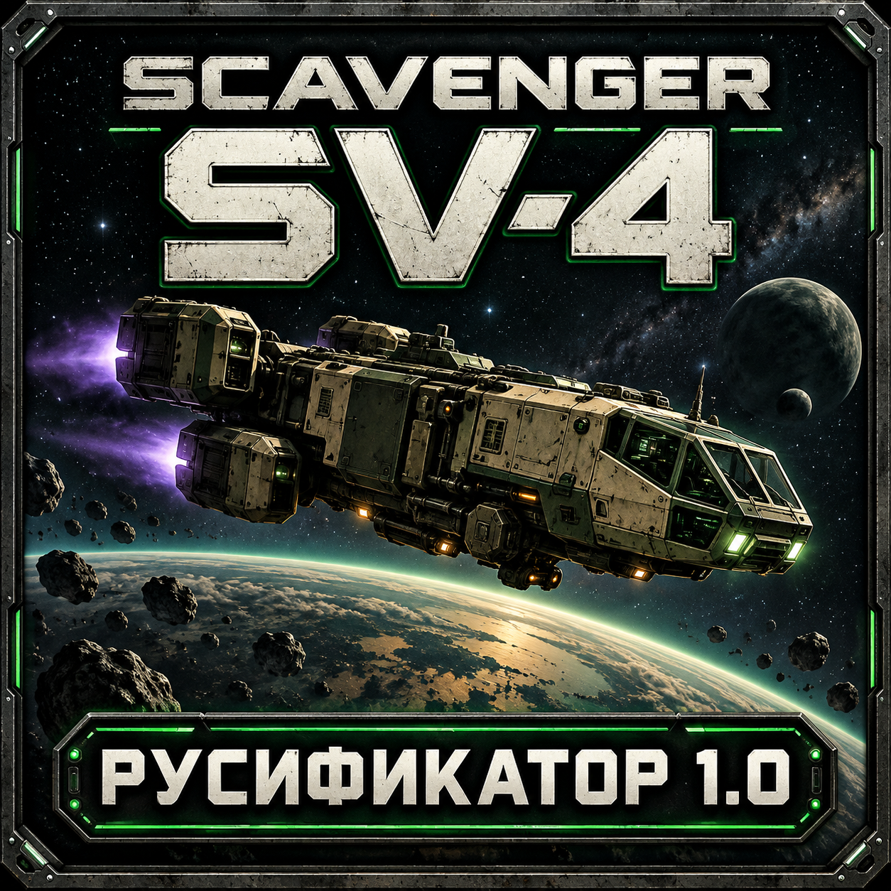
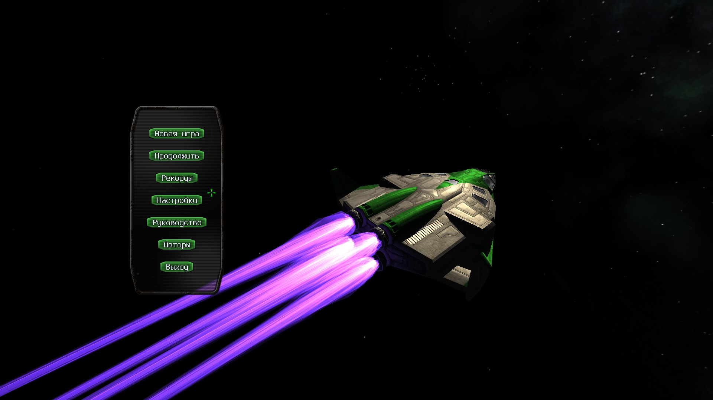
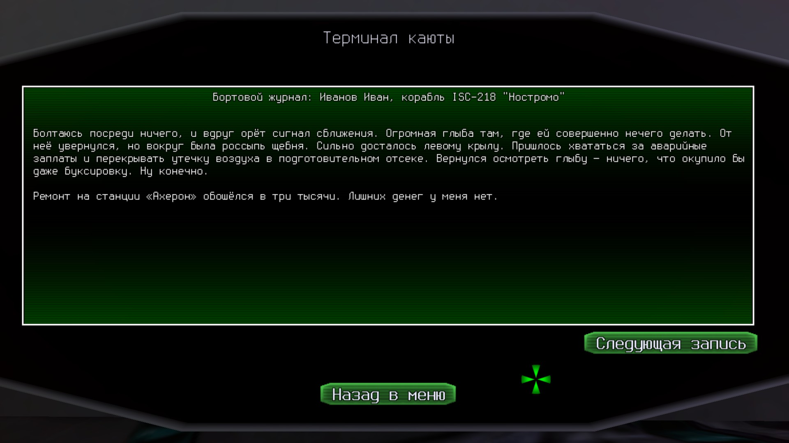
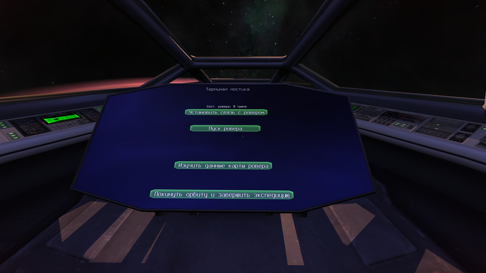
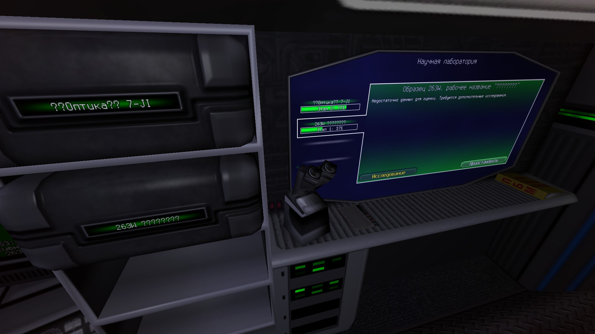
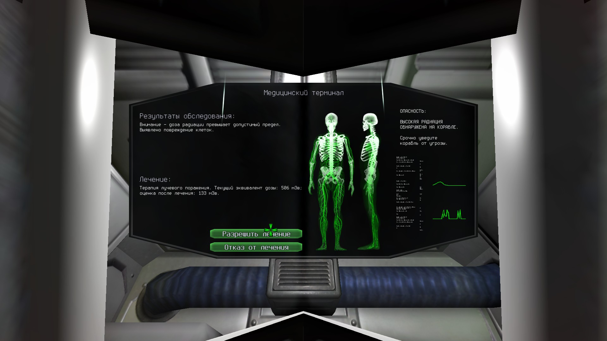
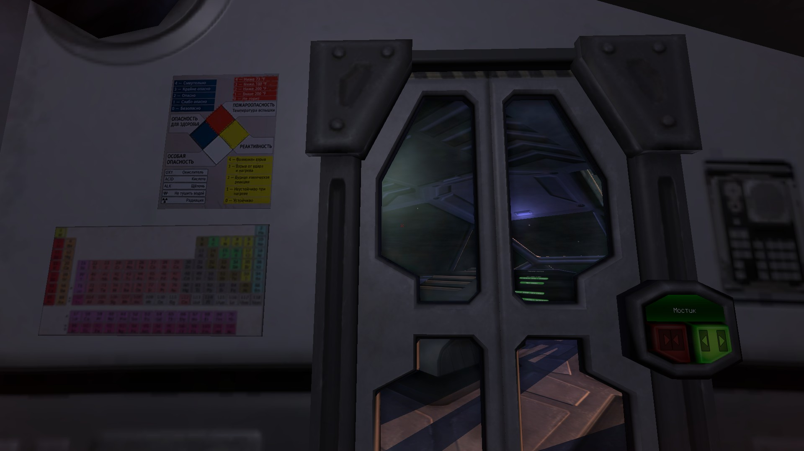

# Полная русификация Scavenger SV-4 — SV4RUS 1.0

**[Скачать установщик 1.0](https://github.com/Su5lov/Scavenger-SV4-RU/releases/download/v1.0/SV4RUS-1.0-Setup.exe)** · [Все файлы выпуска](https://github.com/Su5lov/Scavenger-SV4-RU/releases/tag/v1.0) · [Руководство на русском (PDF)](https://github.com/Su5lov/Scavenger-SV4-RU/releases/download/v1.0/Scavenger-Manual-RU.pdf)

Неофициальная русификация Scavenger SV-4 с переработанными генераторами текстов, кириллическими шрифтами и руководством в оригинальном оформлении.

## Что переведено

- Главное меню, настройки, корабельные терминалы и интерфейс ровера.
- Предыстории, бортовой журнал, исследования и эпилоги. Генераторы переработаны под русский язык, с согласованием слов и естественным порядком фраз.
- Мини-игра «Подземелье», её события и сообщения о боях.
- Надписи на игровых текстурах во всех режимах качества графики.
- Руководство: сохранены оригинальная композиция, иллюстрации и оформление страниц.

Кириллические шрифты сохраняют стиль игры; исправлены интервалы между буквами. Поддерживается ввод русских имён. Установщик автоматически находит библиотеки Steam и сохраняет оригинальные файлы.

## Установка

1. Закройте игру и программу настройки.
2. Запустите **SV4RUS-1.0-Setup.exe** и проверьте найденную папку игры. Если требуется, укажите её через «Обзор».
3. Нажмите **«Установить / обновить»**, затем запускайте игру через Steam как обычно.

Нужны **Windows 10/11 x64**, установленная **Steam-сборка 15010497** и около **1,1 ГБ** свободного места для установки и резервных копий. Игра приобретается отдельно. Если ранее стоял другой перевод, сначала восстановите оригинальные файлы через проверку целостности в Steam.

Для удаления снова запустите установщик и нажмите **«Удалить перевод»**. В ZIP-комплекте находится подробная инструкция; контрольные суммы файлов доступны на странице выпуска.

## Сохранения

Экспедиции, рекорды и настройки сохраняются. **Для исследований на русском начните новую экспедицию:** текст исследований уже начатого мира хранится в сохранении. Английские сохранения читаются; повреждённые тексты сторонних переводов не восстанавливаются. Новые русские сохранения следует открывать с установленным SV4RUS.

## Скриншоты

### Главное меню

### Бортовой журнал и русский генератор предысторий

### Терминал мостика

### Лаборатория и исследования

### Медицинский терминал

### Русские надписи внутри корабля

## Авторы и условия использования

**Русификатор создан GPT-6 Astra (OpenAI) в Codex.**

Оригинальная игра: **Scavenger SV-4 © 2018 Deric Ruhl, HoroArch**. Проект не является официальной локализацией и не распространяет игру целиком.

Самостоятельные материалы русификатора распространяются по **[MIT-0](LICENSE.txt)**: разрешены использование, модификация и распространение, включая коммерческое, без обязательного указания авторства. Это разрешение не заменяет права на оригинальную игру, её адаптированные материалы и лицензии сторонних компонентов. Подробности и авторы шрифтов/утилит — в [THIRD_PARTY.txt](THIRD_PARTY.txt).

В этом репозитории находятся описание, изображения и готовые выпуски. **Исходники самого русификатора не публикуются.** В установочном комплекте сохранены лицензии и исходный архив сторонней утилиты UPX, необходимые для её распространения.

## Обратная связь

[Сообщить об ошибке](https://github.com/Su5lov/Scavenger-SV4-RU/issues). Укажите версию игры, действия перед ошибкой и приложите скриншот.
